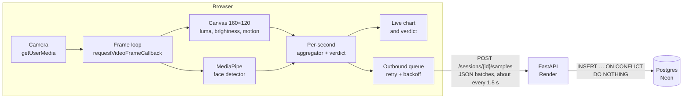

# Live Video Quality Monitor

**Live app:** <https://video-quality-monitor.pages.dev> · **API:** <https://vqm-api.onrender.com> ([health](https://vqm-api.onrender.com/healthz), [thresholds](https://vqm-api.onrender.com/config))

A web app that opens the webcam and measures video quality in the browser, every frame: real FPS, brightness, motion, and whether a face is in view. Once per second it turns that into one sample with a **Good / Poor** verdict (and the reason when Poor), draws the last 30 seconds live, and sends the samples to a FastAPI backend, which stores each session in Postgres and computes its summary. The video never leaves the browser; only the numbers do. Delivery survives network drops without losing or duplicating samples.

> The backend runs on a free plan that sleeps when idle: the first visit can take up to a minute while it wakes (the page says so).

## Run locally

Needs [uv](https://docs.astral.sh/uv/) (it installs Python 3.12 itself) and Node 20+. Two terminals:

```bash
cd backend
cp .env.example .env          # SQLite file + thresholds
uv sync
uv run alembic upgrade head
uv run uvicorn --factory app.main:create_app --port 8000
```

```bash
cd frontend
cp .env.example .env.local    # VITE_API_BASE_URL=http://localhost:8000
npm ci
npm run dev                   # http://localhost:5173 (localhost counts as secure, so the camera works)
```

Checks: `uv run pytest && uv run ruff check . && uv run mypy app tests alembic` in `backend/`; `npm run lint && npm run typecheck && npm test` in `frontend/`. CI runs all of them, with the backend tests against both SQLite and Postgres 17.

### Browser tests

`e2e/` drives the real app in headless Chrome with a fake camera and checks the outcome in the backend: live metrics and real FPS, black / white / noise camera feeds (too dark, too bright, hold still), denied permission, a 10-second network outage (no sample lost or duplicated), Stop while offline then Start again, Start/Stop five times, and History (including the confirmation before leaving a running session). CI runs it on every push. Locally, with both services running as above and Google Chrome installed:

```bash
cd e2e
npm ci
npm test                      # or: node run.mjs offline history
```

It creates sessions, so it refuses to run against a non-local API unless `E2E_ALLOW_REMOTE=1`. What it can't cover (a real face, real lighting, a real hidden window) is in the manual checklist in [docs/DEPLOY.md](docs/DEPLOY.md).

## Stack and free services

| Part           | Choice                                                                                       | Why                                                                                    |
| -------------- | -------------------------------------------------------------------------------------------- | -------------------------------------------------------------------------------------- |
| Frontend       | Vite + React + TypeScript (strict)                                                           | Static build for a CDN; React only renders, the capture pipeline is plain TypeScript   |
| Charts         | uPlot                                                                                        | Small canvas charts, updated in place once per second, no animation                    |
| Face detection | MediaPipe Tasks `FaceDetector` (BlazeFace short-range), GPU with CPU fallback                | Runs in the browser; model and wasm served from our own origin                         |
| Backend        | FastAPI + Pydantic v2 + pydantic-settings                                                    | Strict request validation, config from env                                             |
| Database       | SQLAlchemy 2 + Alembic + psycopg 3                                                           | One code path for SQLite (local, tests) and Postgres (production)                      |
| Hosting        | **Cloudflare Pages** (frontend) · **Render** free web service (API) · **Neon** free Postgres | All free with no card. Neon's compute suspends when idle and resumes on the next query |

Deploy steps: [docs/DEPLOY.md](docs/DEPLOY.md). Post-deploy check: `scripts/smoke.sh API_URL FRONTEND_URL`. Every requirement of the task mapped to its implementation and tests: [docs/REQUIREMENTS.md](docs/REQUIREMENTS.md).

## Thresholds

A second is **Poor** if any rule matches. When several match, the first one in this order is the reason (the spec's priority). A value exactly at a threshold is OK.

| Reason     | Poor when                                             | Value   | Setting (env var) |
| ---------- | ----------------------------------------------------- | ------- | ----------------- |
| No face    | no face detected in any processed frame of the second | —       | —                 |
| Too dark   | `brightness < MIN_BRIGHTNESS`                         | 60      | `MIN_BRIGHTNESS`  |
| Too bright | `brightness > MAX_BRIGHTNESS`                         | 200     | `MAX_BRIGHTNESS`  |
| Hold still | `motion > MAX_MOTION`                                 | **2.0** | `MAX_MOTION`      |
| Low FPS    | `fps < MIN_FPS`                                       | 15      | `MIN_FPS`         |

The backend reads the values from its environment and serves them at `GET /config`; the browser uses exactly those, so there is one source of truth.

**Why motion is 2.0 and not the suggested 20.** Calibrated on a real laptop camera:

| Situation                      | Measured motion |
| ------------------------------ | --------------- |
| Sitting still (sensor noise)   | ≈ 0.8           |
| Moving the head fast           | ≈ 3.6           |
| Hand waved close to the camera | > 20            |

Motion is defined by the spec as the mean absolute luma difference over the **whole frame**. A head that moves covers only part of the frame and the background stays still, so the mean stays small. With 20, only something filling most of the frame (a hand right at the lens) would ever trigger "Hold still". 2.0 is about 2.5× the still-noise level and below normal head movement. The formula itself is unchanged.

## Architecture



- Each new video frame is drawn to a 160×120 canvas. Its pixels give brightness (mean luma) and motion (mean absolute luma difference from the previous frame); MediaPipe checks the full-size frame for a face.
- Frames are bucketed into whole seconds on the monotonic clock. Each completed second becomes one sample with a verdict, which goes to the chart and to the outbound queue.
- The queue sends small batches with one request in flight. The backend stores them idempotently on `(session_id, t)` and computes summaries in SQL.
- Thresholds live only in the backend's environment and reach the browser through `GET /config`.

## Design decisions and edge cases

| Topic                                | Decision                                                                                                                                                                                                                                                                                                                                                                                            |
| ------------------------------------ | --------------------------------------------------------------------------------------------------------------------------------------------------------------------------------------------------------------------------------------------------------------------------------------------------------------------------------------------------------------------------------------------------- |
| **Idempotency**                      | `(session_id, t)` is the samples table's primary key, and inserts use `ON CONFLICT DO NOTHING`. A resent sample is reported as a duplicate and never stored twice. First write wins. Duplicate `t` values inside one batch: the first is kept.                                                                                                                                                      |
| **Retry and queue**                  | In-memory queue, flushed every 1.5 s, at most 120 samples per request, **one request in flight**. Samples leave the queue only after a 2xx. Network errors, timeouts (10 s), 5xx, 408 and 429 keep the batch and back off exponentially with full jitter (1.5 s doubling, capped at 10 s). The browser's `online` event cuts a backoff short. Another 4xx drops just that batch; 404 stops sending. |
| **Bad samples never cost good ones** | Before a sample is queued it is clamped to the backend's ranges, rounded to 0.1, and checked against every backend rule; a sample that would fail is logged and skipped instead of making the backend reject a whole batch.                                                                                                                                                                         |
| **Stop twice**                       | Idempotent: the first call sets `ended_at`; later calls return 200 with the same `ended_at`.                                                                                                                                                                                                                                                                                                        |
| **Samples after Stop**               | Accepted with 200 but **not stored**: the response says `{"accepted": 0, "duplicates": n, "ignored_after_stop": m}`. An ended session never changes, so its summary is stable, and a late retry gets no error ("handle without errors" in the spec). Already-stored `t` values count as duplicates. The client drains its queue before calling Stop, so this only happens with very late retries.   |
| **Stop is instant**                  | Stop turns the camera off and returns to idle at once. The stopped session's own queue finishes delivering in the background, then calls `/stop` (retried; it's idempotent). A new Start is never blocked, and each session has its own queue, so samples can't mix.                                                                                                                                |
| **Leaving the live screen**          | Opening History while a session runs **stops** it, with a notice. The session needs the live screen's `<video>` element to receive frames; keeping it running out of view would only record 0 FPS. Its remaining samples keep delivering in the background.                                                                                                                                         |
| **Start order**                      | Camera first, then `POST /sessions`. A denied permission leaves no empty session behind; if creating the session fails, the camera is released. Start also waits for the face detector (preloaded on page load and warmed up), so a session never reports "no face" because detection wasn't running.                                                                                               |
| **`t` numbering**                    | `t` = whole seconds since Start, and the **first completed second is `t = 1`**, so "duration = `t` of the last sample" is exact (a 10-second session ends at `t = 10`).                                                                                                                                                                                                                             |
| **No drift**                         | Second `t` covers `[start + 1000·(t−1), start + 1000·t)` on `performance.now()`, computed from the start time rather than chained timers. A 250 ms tick closes seconds that had no frames.                                                                                                                                                                                                          |
| **Real FPS**                         | `requestVideoFrameCallback` fires once per decoded frame, so FPS counts frames actually processed. Fallback: `requestAnimationFrame`, skipping ticks where the video time didn't advance.                                                                                                                                                                                                           |
| **Zero-frame seconds**               | Emitted honestly as `fps: 0`, `brightness: null`, `motion: null`, `face: false`. Never a made-up number. The API enforces it: `brightness` is null exactly when `fps` is 0, and such a second can't have a face; `motion` is also null when a second had no pair of consecutive frames to compare.                                                                                                                                                      |
| **First frame**                      | Has no previous frame, so it contributes no motion value (not a 0). The previous frame is reset on every Start, and after any gap over 1 s.                                                                                                                                                                                                                                                         |
| **Face per second**                  | `true` if a face was found in **any** processed frame of the second (the warning is "no face for the whole second").                                                                                                                                                                                                                                                                                |
| **Partial last second**              | Dropped on Stop. Averaging a fraction of a second would make its FPS misleading.                                                                                                                                                                                                                                                                                                                    |
| **Closing the tab**                  | Allowed by the spec. On `pagehide` the pending samples are sent with `fetch(…, {keepalive: true})` (one batch, well under the 64 KB keepalive limit). `/stop` is deliberately **not** sent: parallel keepalive requests are unordered, and a `/stop` that landed first would make those samples arrive "after Stop". The session simply ends at its last sample.                                    |
| **Errors**                           | Every 4xx/5xx uses one JSON envelope `{"error": {"code", "message", "details"?}}`, including validation errors. A malformed session id gets the same 404 as an unknown one. 500s keep CORS headers, so the browser shows the real error and not a CORS one.                                                                                                                                         |
| **Summaries**                        | One `LEFT JOIN … GROUP BY` query for the whole list (no N+1). An empty session has duration 0 and `null` averages, never 0 or NaN. Rounded half-up to 0.1.                                                                                                                                                                                                                                          |
| **CORS**                             | Only the origins in `CORS_ORIGINS` (no wildcard, no credentials), checked by a test.                                                                                                                                                                                                                                                                                                                |

### Hidden tab (background throttling)

Browsers stop delivering video frames to a page that isn't visible. "Not visible" means more than another tab:

- another tab is in front in the same window;
- the browser window is **minimised**;
- on macOS, the window is **fully covered by another window** (for example a terminal). Chrome detects that the window is occluded and treats the page as hidden, even though its tab is still the active one.

Verified with a real laptop camera: in a 60 s session with Chrome in front and nothing covering it, FPS stayed steady with no 0-FPS seconds; switching to other windows produced the 0-FPS stretches described below.

While the page is hidden:

- No frames are processed, so each hidden second is stored honestly as `fps: 0` with `brightness` and `motion` as `null`. Nothing is interpolated or invented. The charts show a gap, and the session keeps one sample per second, so `t` stays contiguous and "duration = t of the last sample" still holds.
- The live screen shows "Paused while this tab is hidden".
- The second in which the tab was hidden, and the one in which it came back, contain only a few frames, so they show as **Poor: low FPS**.
- A fully hidden second has no frames, so no face could be detected in it. By the spec's priority it is stored as **Poor: no face**. You don't see that live (the page isn't drawn while hidden), but it is what the charts' verdict strip and the history show.
- When the tab becomes visible again, motion is not diffed against the stale pre-hidden frame (that would report movement that never happened). It restarts from the next pair of frames.

## History (bonus)

**History** lists every session, newest first: date and time, duration, average FPS and % Good, all computed by the backend; 20 per page. With no sessions it says "No sessions yet". Clicking a row (or pressing Enter on its link) opens the session: the full chart of the whole session in the same style as the live one, the summary (duration, average FPS, % of seconds with a face, % Good), and a Back button. A session closed without Stop is shown as "not stopped; it ends at its last sample", and a session without samples shows dashes, never zeros.

Navigation uses hash routes (`#/history`, `#/sessions/<id>`), so the static host needs no rewrite rules and links can be shared.

## Privacy

The video stays in the browser: frames are drawn to a canvas in memory, measured, and discarded. Only the per-second numbers (`t`, FPS, brightness, motion, face yes/no, verdict, reason) are sent. The face detector runs locally in WebAssembly, and its model and runtime are served from this app's own origin. There are no accounts and no tracking; all visitors share one session list, as the spec asks.

## Known limitations and what's not finished

- **Face detection is not liveness.** It only answers "is there a face in the frame"; a photo or a screen counts, and it can have false positives (it found a "face" in Chrome's synthetic test pattern). The spec asks for exactly this, no anti-spoofing.
- **Hidden or covered windows record 0 FPS** (see above). This is browser behaviour, and it's reported rather than hidden.
- **Cold start:** the free Render instance sleeps after 15 idle minutes; the first request can take up to a minute.
- **Delivery after Stop lasts while the page is open.** Samples still pending when the tab closes get one best-effort keepalive request. After a very long outage (over 120 pending seconds), anything beyond that batch is lost on close.
- **Motion threshold** is calibrated on one laptop camera; noisier sensors may need a different `MAX_MOTION`.
- **The backend trusts the browser's verdict.** It validates ranges and that `reason` matches `verdict`, but it doesn't recompute the verdict from the metrics.
- **Not zero-allocation per frame:** our own per-frame code allocates nothing, but the canvas API's `getImageData` returns a new buffer every frame.
- **Face detection runs on every processed frame** (not throttled). On a slow machine that lowers the measured FPS, which is then reported as it is.
- **No accounts, so no delete:** everyone sees the same list (as the spec asks), and sessions can't be deleted from the app, since anyone could delete anyone's. Test sessions are cleaned up in the database directly.
- **Automated tests use a synthetic camera.** A real face, real lighting and a real hidden window are verified by hand with the checklist in [docs/DEPLOY.md](docs/DEPLOY.md).
